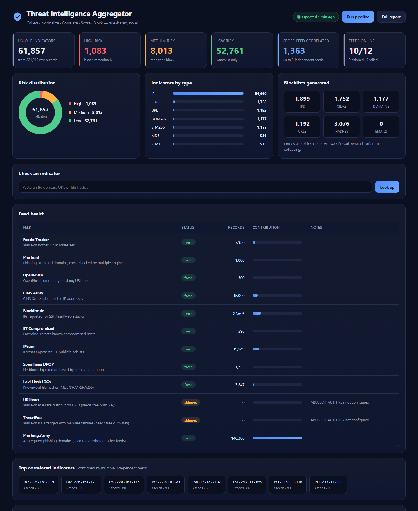
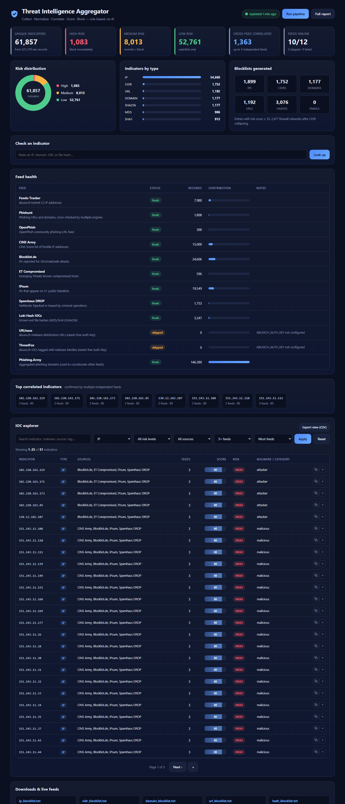
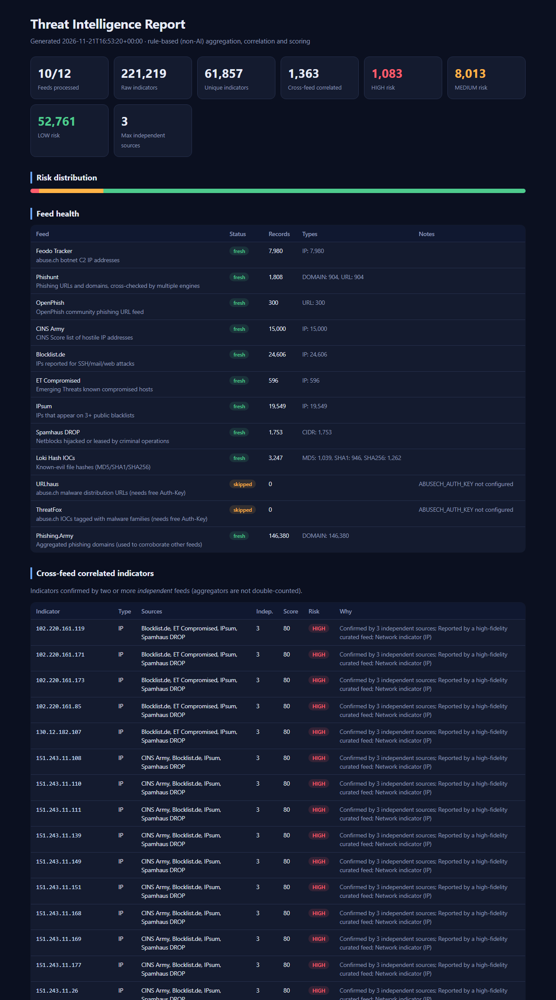
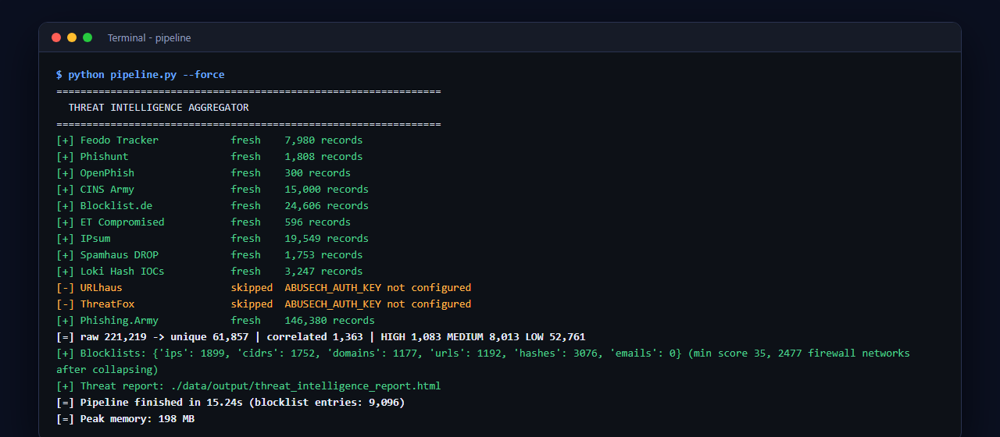
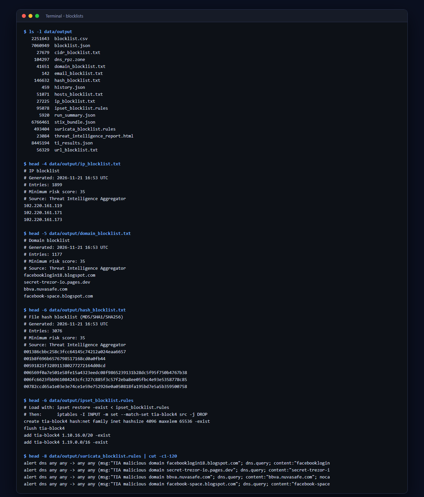
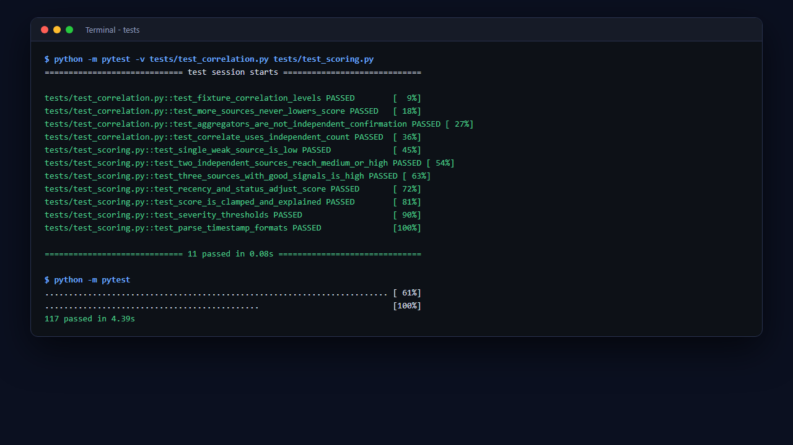
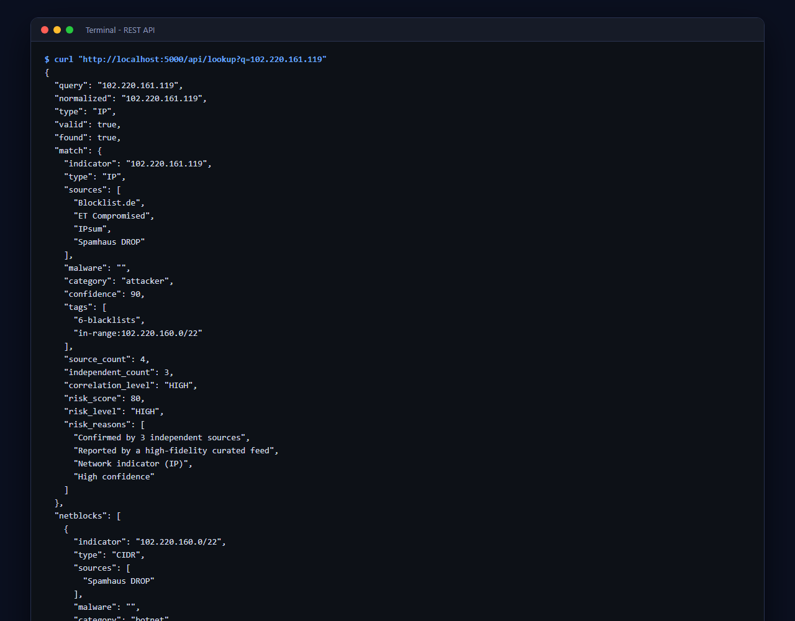

# Threat Intelligence Aggregator

A **non-AI** threat-intelligence platform that collects indicators of compromise (IOCs) from many public feeds, normalizes and de-duplicates them, **correlates them across independent sources**, scores them with a transparent rule engine, and exports deployment-ready blocklists, all behind a Flask dashboard and REST API.

**Live application:** https://threat-intelligence-aggregator-30md.onrender.com
*(Render free tier: the first request after idle can take a minute while the first snapshot is built.)*

## Walkthrough video


https://github.com/user-attachments/assets/811bc8d1-8a75-4e59-b4fb-94a03c811feb


It shows the live console, feed health, cross-feed correlation, explainable scores, the indicator lookup, the exported blocklists and the threat report. (On GitHub, click the image or link and the video opens in the browser player.)

## Screenshots

| Dashboard | Correlated IOC explorer |
|---|---|
|  |  |



<details>
<summary>More screenshots: pipeline run, blocklists, tests, REST API</summary>

| Pipeline run | Generated blocklists |
|---|---|
|  |  |

| Automated tests | REST API lookup |
|---|---|
|  |  |

</details>

## What it does

```
 12 feeds (+ local files, STIX, TAXII)        10 are live without any API key
        |  parallel download · retries · cache · stale fallback
        v
   Parse  (CSV · TXT · JSON · STIX 2.x · free text · defang-aware)
        v
   Validate + Normalize  (IP · CIDR · domain · URL · MD5/SHA1/SHA256 · e-mail)
        v   de-duplicate, merge metadata, derive hosts from URLs
   False-positive guard  (private IPs, big-vendor and shared-hosting apexes)
        v
   Correlate  (independent-source matching, aggregator de-weighting, CIDR range hits)
        v
   Score 0-100  (explainable rules)  ->  LOW / MEDIUM / HIGH
        v
   Export  (ipset · hosts · DNS RPZ · Suricata · STIX 2.1 · CSV · JSON · TXT) + HTML report
        v
   Dashboard + REST API + live External Dynamic Lists
```

A typical live run processes about **220,000 raw records into ~61,800 unique indicators in ~15 s** at roughly **200 MB peak memory**. About 1,300 indicators are confirmed by two or more *independent* feeds, and the pipeline emits ~9,000 blocklist entries.

## Highlights

- **Real cross-feed correlation.** Feeds that overlap by design (IP reputation lists, phishing URL/domain lists, CIDR netblocks) are matched on normalized indicators. Domains and IPs are also *derived from URLs*, so a URL in one feed corroborates a domain in another. IPs inside a listed Spamhaus DROP netblock inherit that corroboration.
- **No double counting.** Aggregators (IPsum, Phishing.Army) are not counted as independent confirmation of the feeds they republish.
- **Explainable scoring.** Every indicator carries the list of reasons behind its score, visible in the UI, API and report.
- **False-positive controls.** Private/non-routable IPs, DNS resolvers, major vendors and free-hosting apexes (`pages.dev`, `blogspot.com`, ...) are never emitted, while abusive *sub*domains still are. Shared CDN hosting IPs from phishing feeds are intentionally ignored.
- **Resilient collection.** One feed failing, timing out or returning garbage never stops a run; the last good copy is used (`stale`) and every feed's health is shown.
- **Many output formats.** Plain lists, ipset restore file (with CIDR collapsing), hosts file, DNS RPZ zone, Suricata/Snort rules, STIX 2.1 bundle, CSV and JSON.
- **Indicator lookup.** Paste an IP, domain, URL or hash to see whether it is known and why. This also covers IPs inside listed netblocks.
- **Live External Dynamic Lists** (`/feeds/ip.txt?min_score=60`) that firewalls can poll directly.
- **Security-minded web layer.** Strict CSP, no inline scripts, escaped output everywhere (feed data is untrusted), whitelisted downloads, CSV formula-injection protection, token-protected and rate-limited run endpoint.

## Feeds

| Feed | Type | Notes |
|---|---|---|
| Feodo Tracker | botnet C2 IPs | abuse.ch, aggressive list |
| Phishunt | phishing URLs / domains | confidence rises with each agreeing engine |
| OpenPhish | phishing URLs | |
| Phishing.Army | phishing domains | corroboration-only (never creates standalone IOCs) |
| CINS Army | hostile IPs | |
| Blocklist.de | attacker IPs | |
| ET Compromised | compromised hosts | |
| IPsum | IPs on 3+ blacklists | aggregator |
| Spamhaus DROP | hijacked CIDR netblocks | |
| Loki Hash IOCs | MD5 / SHA1 / SHA256 | |
| URLhaus | malware URLs | needs a free abuse.ch Auth-Key |
| ThreatFox | multi-type IOCs | needs a free abuse.ch Auth-Key |

Plus any TXT / CSV / JSON / **STIX 2.x** file dropped into `data/local/`, and an optional **TAXII 2.1** collection (`TAXII_COLLECTION_URL`). Adding a feed is one entry in `feeds.py`.

## Scoring model

| Signal | Points |
|---|---|
| Independent corroboration | 1 source +10 · 2 sources +35 · 3 sources +50 · 4+ sources +60 |
| Best source reputation | 0-15 |
| Indicator type | hash 15 · URL 12 · CIDR 10 · IP / domain 8 · e-mail 4 |
| Source confidence | ≥80 +10 · ≥50 +5 |
| High-risk category (botnet, malware, phishing, ...) | +8 |
| Recency | seen ≤7 days +7 · ≤30 days +3 · >180 days -10 |
| C2 confirmed online | +10 |
| Infrastructure offline | -10 |

`HIGH` ≥ 60 · `MEDIUM` ≥ 35 · `LOW` < 35. Blocklists include everything at or above `BLOCKLIST_MIN_SCORE` (default 35). Thresholds and weights live in `core/risk_scoring.py` and `feeds.py`.

## Quick start

```bash
python -m venv venv
venv\Scripts\activate            # Linux/macOS: source venv/bin/activate
pip install -r requirements.txt

python pipeline.py               # run the full pipeline once (CLI)
python app.py                    # dashboard on http://localhost:5000
```

CLI options:

```bash
python pipeline.py --list-feeds          # show configured feeds
python pipeline.py --force               # ignore the cache, re-download everything
python pipeline.py --samples             # also load the bundled STIX/CSV/JSON/TXT demo feeds
python pipeline.py --only Feodo\ Tracker Phishunt
python pipeline.py --min-score 60        # stricter blocklists
```

## Configuration

Everything is optional. Copy `.env.example` to `.env` and adjust:

| Variable | Default | Purpose |
|---|---|---|
| `ABUSECH_AUTH_KEY` | empty | Free abuse.ch key; enables URLhaus and ThreatFox |
| `ADMIN_TOKEN` | empty | If set, `POST /api/run` requires header `X-Admin-Token` |
| `RUN_COOLDOWN_SECONDS` | `300` | Minimum gap between dashboard-triggered runs |
| `BLOCKLIST_MIN_SCORE` | `35` | Minimum risk score for blocklist inclusion |
| `STALE_AFTER_HOURS` | `12` | Auto-refresh when stored results are older than this |
| `STORE_LOW_CAP` | `2000` | LOW-risk indicators kept in `ti_results.json` (counts stay exact) |
| `ALLOW_DOMAINS` / `ALLOW_IPS` | empty | Comma-separated indicators that must never be blocked |
| `INCLUDE_SAMPLES` | `0` | `1` loads the demo feeds in `data/samples/` |
| `TAXII_COLLECTION_URL`, `TAXII_USER`, `TAXII_PASSWORD` | empty | Optional TAXII 2.1 collection |

## REST API

| Endpoint | Description |
|---|---|
| `GET /api/iocs` | Filtered, paginated indicators (`type, risk, source, min_sources, search, sort, page, per_page`) |
| `GET /api/iocs.csv` | Same filters, CSV export |
| `GET /api/lookup?q=` | Look up one IP, domain, URL or hash |
| `GET /api/summary` | Run summary + per-feed health |
| `GET /api/status` | Pipeline state, cooldown |
| `POST /api/run` | Start a run in the background (`X-Admin-Token` if `ADMIN_TOKEN` is set; 5-minute cooldown) |
| `GET /feeds/{ip,cidr,domain,url,hash,email}.txt?min_score=` | Plain-text External Dynamic Lists |
| `GET /health` | Liveness probe |
| `GET /download/<file>` | Whitelisted output files |
| `GET /report` | Full HTML threat report |

## Output files (`data/output/`)

`ip_blocklist.txt` · `cidr_blocklist.txt` · `domain_blocklist.txt` · `url_blocklist.txt` · `hash_blocklist.txt` · `email_blocklist.txt` · `ipset_blocklist.rules` · `hosts_blocklist.txt` · `dns_rpz.zone` · `suricata_blocklist.rules` · `stix_bundle.json` · `blocklist.csv` · `blocklist.json` · `ti_results.json` · `run_summary.json` · `threat_intelligence_report.html`

A snapshot of the small blocklists and the report is committed as example output. The large files (`ti_results.json`, `blocklist.json`, `stix_bundle.json`, `history.json`) and the downloaded feed cache are git-ignored and regenerated on every run.

```bash
ipset restore -exist < data/output/ipset_blocklist.rules
iptables -I INPUT -m set --match-set tia-block4 src -j DROP
```

## Testing

```bash
pip install -r requirements.txt     # includes pytest
python -m pytest
```

The suite (117 tests, fully offline) covers validation and defanging, normalization, allow-listing, CIDR range matching, correlation and aggregator de-weighting, scoring, every parser (including STIX and ThreatFox payloads), blocklist formats and a STIX export → parse round trip, XSS and CSV-injection safety, the fetcher (retries, cache, stale fallback), the pipeline end to end, TAXII pagination, and the whole web API including auth, cooldown and download whitelisting. A GitHub Actions workflow runs it on Python 3.10 and 3.12.

## Deployment

- **Render:** use `pip install -r requirements.txt` as the build command and `gunicorn app:app --workers 1 --threads 4 --timeout 120` as the start command. A single worker is deliberate: the run lock and cooldown live in process memory. The `Procfile` contains the same command for Heroku-style hosts. Set `ADMIN_TOKEN` in the environment to require a token for manual runs.
- **Docker:** `docker build -t tia . && docker run -p 8000:8000 tia`
- The first request after a cold start builds the snapshot in the background and the page refreshes itself. Data older than `STALE_AFTER_HOURS` refreshes automatically.
- Peak memory is about 200 MB per run, which fits Render's 512 MB free tier.

## Project layout

```
app.py                Flask dashboard + REST API
pipeline.py           orchestration + CLI
feeds.py              feed registry (add feeds here)
config.py             environment-driven settings
collectors/           HTTP fetcher (retries, cache), TAXII 2.1 client
parsers/              CSV, TXT, JSON, STIX, feed-specific and line-based parsers
core/                 validator, normalizer, allowlist, CIDR ranges, correlator, risk scoring
generators/           blocklists (all formats) + HTML report
templates/ static/    dashboard UI
data/samples/         synthetic TXT/CSV/JSON/STIX demo feeds
data/local/           drop your own feed files here (see its README)
data/output/          generated blocklists and report
tests/                pytest suite (117 tests)
docs/                 project report (PDF), walkthrough video and its thumbnail
screenshots/          screenshots of the running application
.github/workflows/    CI (pytest on Python 3.10 and 3.12)
Dockerfile, Procfile, .env.example, requirements.txt, pytest.ini
```

## Limitations (honest notes)

- URLhaus and ThreatFox are implemented and unit-tested against recorded payload shapes, but they require a free abuse.ch Auth-Key and have not been exercised against the live API in this repository.
- The TAXII client is tested against a mocked server only.
- Public OSINT feeds contain false positives; review blocklists before enforcing them on production traffic.
- Scoring is deterministic and rule-based by design. There is no machine learning.

## License / purpose

Built as an internship project for educational and defensive cybersecurity purposes. Feed data remains subject to each provider's terms of use.
